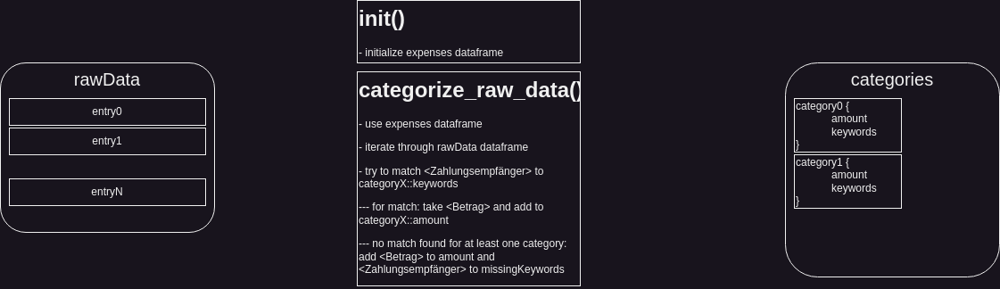

# DKB Analyze

Analyze account exports (CSV) from the German bank DKB: income, expenses and
balance per week, month or year, broken down by category. Results are printed
as a text report or explored in an interactive terminal dashboard.

## Usage

```sh
cargo run --release -- [OPTIONS] <CSV>...
```

| Option | Description |
| --- | --- |
| `<CSV>...` | One or more DKB exports. Multiple files (e.g. several months) are combined. |
| `-c, --categories <FILE>` | TOML file with category keywords. Default: `./categories.toml` if present, otherwise built-in categories. |
| `-p, --period <weekly\|monthly\|yearly>` | Grouping of the balance table and charts. Default: `monthly`. |
| `-t, --tui` (alias `--visualize`) | Open the interactive terminal dashboard instead of printing the report. |
| `--top-uncategorized <N>` | Number of uncategorized counterparties listed in the report. Default: `10`. |

Try it with the bundled sample data:

```sh
cargo run -- examples/dkb-export-sample.csv
cargo run -- -c categories.example.toml --tui examples/dkb-export-sample.csv
```

Status messages and warnings go to stderr, so the report on stdout can be
redirected to a file (`> report.txt`).

### Text report

```text
════════════════════════════════════════════════════════════════════════
 OVERVIEW                                       01.07.2024 – 24.12.2024
────────────────────────────────────────────────────────────────────────
  Income                       16.000,00 €
  Expenses                     -9.916,04 €
  Balance                       6.083,96 €
  Transactions                          92
  Uncategorized                          0   (0,00 €)
════════════════════════════════════════════════════════════════════════
 EXPENSES BY CATEGORY
────────────────────────────────────────────────────────────────────────
  Housing                    -6.432,00 €   64.9 %  ████████████████████
  Groceries                  -1.580,51 €   15.9 %  █████
  ...
════════════════════════════════════════════════════════════════════════
 MONTHLY BALANCE
────────────────────────────────────────────────────────────────────────
  Period            Income        Expenses         Balance
  2024-07       2.650,00 €     -1.591,80 €      1.058,20 €  ██████████████████
  2024-08       2.650,00 €     -1.554,69 €      1.095,31 €  ███████████████████
  ...
  Average                                       1.013,99 €
```

If some spending is uncategorized, a **TOP UNCATEGORIZED** section lists
the counterparties with the highest uncategorized spending. These are good
candidates for new keywords.

### Terminal dashboard (`--tui`)

```text
┌ dkb-analyze · Monthly ─────────────────────────────────────── 01.07.2024 – 24.12.2024 ┐
│ Dec 24      Income 2.750,00 €   Expenses -1.587,95 €   Balance 1.162,05 €   ...       │
└───────────────────────────────────────────────────────────────────────────────────────┘
┌ ■ Income  ■ Expenses  per month (€) ──────────────────────────────────────────────────┐
│▃▃▃▃▃▃           ▃▃▃▃▃▃           ▃▃▃▃▃▃           ▃▃▃▃▃▃           ██████              │
│██████ ██████    ██████ ▇▇▇▇▇▇    ██████ ██████    ██████ ██████    ██████ ██████       │
│█2.6k█ █1.6k█    █2.6k█ █1.6k█    █2.6k█ █1.8k█    █2.6k█ █1.6k█    █2.8k█ █1.6k█       │
│   Aug 24           Sep 24           Oct 24           Nov 24           Dec 24           │
└───────────────────────────────────────────────────────────────────────────────────────┘
┌ Expenses by category · Dec 24 ─────────┐┌ Transactions · Dec 24 (15) ─────────────────┐
│Housing        -1.072,00 €  68% ███████ ││  Date       Counterparty  Category    Amount│
│Groceries        -300,88 €  19% ██      ││▶ 24.12.2024 Oma Anneliese Income    100,00 €│
│Transportation    -76,20 €   5% █       ││  23.12.2024 ALDI SUED     Groceries -86,08 €│
└────────────────────────────────────────┘└─────────────────────────────────────────────┘
 ←/→ period   a all/one   Tab week/month/year   ↑/↓ scroll   q quit
```

| Key | Action |
| --- | --- |
| `←` `→` / `h` `l` | Select the previous / next period |
| `a` | Toggle between the selected period and all periods |
| `Tab` / `g` | Cycle weekly → monthly → yearly |
| `w` `m` `y` | Switch to weekly / monthly / yearly directly |
| `↑` `↓` / `j` `k`, `PgUp` `PgDn`, `Home` `End` | Scroll the transaction list |
| `q` / `Esc` / `Ctrl+C` | Quit |

The bar chart shows as many periods as fit the terminal width and scrolls so
that the selected period stays visible. When you switch the grouping, the
selection stays at the same point in time (e.g. week 49 → December).

## Categories

Categories are defined in a TOML file. Copy
[`categories.example.toml`](categories.example.toml) to `categories.toml`.
That file is git-ignored, so your personal keywords stay private, and it is
picked up automatically.

```toml
Housing = ["hausverwaltung", "miete", "stadtwerke"]
Groceries = ["rewe", "edeka", "aldi", "lidl"]
Shopping = ["paypal", "amazon"]
```

Rules:

- Keywords match case-insensitively as substrings. They are checked against
  the recipient ("Zahlungsempfänger*in") first. Only if no category matches
  are they checked against the purpose ("Verwendungszweck").
- Categories are checked from top to bottom, and the first match wins.
- Positive amounts always count as **Income**. Spending without a match is
  **Uncategorized**. Both names are reserved.

## Supported input formats

- **Current DKB export** (since 2023): semicolon-separated, with metadata lines
  (account, period, balance) before the German header row, and dates such as
  `15.10.24`.
- **Legacy DKB export**: `Buchungstag` / `Auftraggeber / Begünstigter`
  columns, ISO-8859-1 encoded.
- **Header-less or English-header files** with the DKB column layout,
  comma- or semicolon-separated (see [`examples/spendings.csv`](examples/spendings.csv)).

The delimiter and encoding are detected automatically, and columns are
located by their header names. German amounts (`-1.234,56`) are parsed
exactly. Rows that start with a date but have an unreadable amount are
skipped, with a warning that gives the line number.

## Architecture

```text
src/
├── main.rs         CLI (clap): argument parsing, loading inputs, choosing report or TUI
├── lib.rs          Library root and error type
├── money.rs        Amount: integer cents, German parsing and formatting
├── transaction.rs  Transaction model
├── parser.rs       DKB CSV reader (delimiter/encoding/header detection)
├── categories.rs   Categorizer: TOML loading and keyword matching
├── analysis.rs     Totals per week/month/year and per category
├── report.rs       Plain-text report
└── tui.rs          Interactive dashboard (ratatui)
tests/cli.rs        End-to-end tests of the binary
examples/           Fictional sample exports
```

Data flows in one direction: `parser` → `categories` → `analysis` →
`report` / `tui`. Everything except `main.rs` is a library (`dkb_analyze`),
so the analysis can be reused or tested without the CLI.

Original concept sketch:


## Development

```sh
cargo test                   # unit tests, dashboard render tests (TestBackend), CLI tests
cargo clippy --all-targets
cargo fmt
```

## Changes in 0.2.0

This release refactors the whole project and adds visualization.

**New**

- Terminal dashboard (`--tui`) built with [ratatui](https://ratatui.rs): an
  income/expense bar chart per period, a category breakdown, and a scrollable
  transaction list. You can navigate periods and switch between weekly,
  monthly and yearly grouping.
- Monthly balance table in the text report, with balance bars and an average.
  Weekly (ISO weeks) and yearly grouping are available via `--period`.
- Multiple input files in one run.
- "Top uncategorized" list to help extend the categories.
- Categories are loaded at runtime from a TOML file
  (`categories.example.toml`). This replaces the compiled-in
  `categories_private.rs`.
- Works with real DKB exports: metadata lines, German headers, `;`/`,`
  delimiter detection, legacy format, and ISO-8859-1 / UTF-8 BOM handling.
- Sample data in `examples/` and 29 tests (unit, render and CLI).

**Fixed**

- The project did not compile without the git-ignored
  `src/categories_private.rs`.
- The input path fell back to a hard-coded personal path
  (`/home/franz/...`). The input file is now a required argument.
- The parser expected `;`, but the bundled sample used `,`. The delimiter
  is now detected.
- Unparseable amounts silently counted as `0.0`. They are now reported as
  warnings.
- Money used `f64` and was truncated for display. It is now exact integer
  cents.
- The program crashed (`category_totals["Income"]`) when a file had no
  income or no uncategorized entries.
- Category matching depended on `HashMap` iteration order, so it was
  random. It now follows file order.
- Category keywords are now lowercased too, so `"PayPal"` matches.
- A missing `--categories` file now causes an error instead of silently
  falling back.

**Changed / removed**

- CLI flags: `--input <FILE>` became positional `<CSV>...`.
  `--monthly` became `--period monthly|weekly|yearly`, and monthly is the
  default. `--visualization` became `--tui` (alias `--visualize`).
- Removed the unused `plotters` and `env_logger` dependencies. Added
  `ratatui`, `chrono`, `toml`, `thiserror` and `anyhow`.
- Removed `scripts/translateHeader.sh`. German headers are understood
  directly, so it is no longer needed (it was also broken: its shebang was
  not on the first line).
- Moved `src/spendings.csv` to `examples/spendings.csv`.
- Rust edition 2021 → 2024.

<p align="center" width="100%">
<a href="https://buymeacoffee.com/typoatlinezero" target="_blank"></a>
</p>
